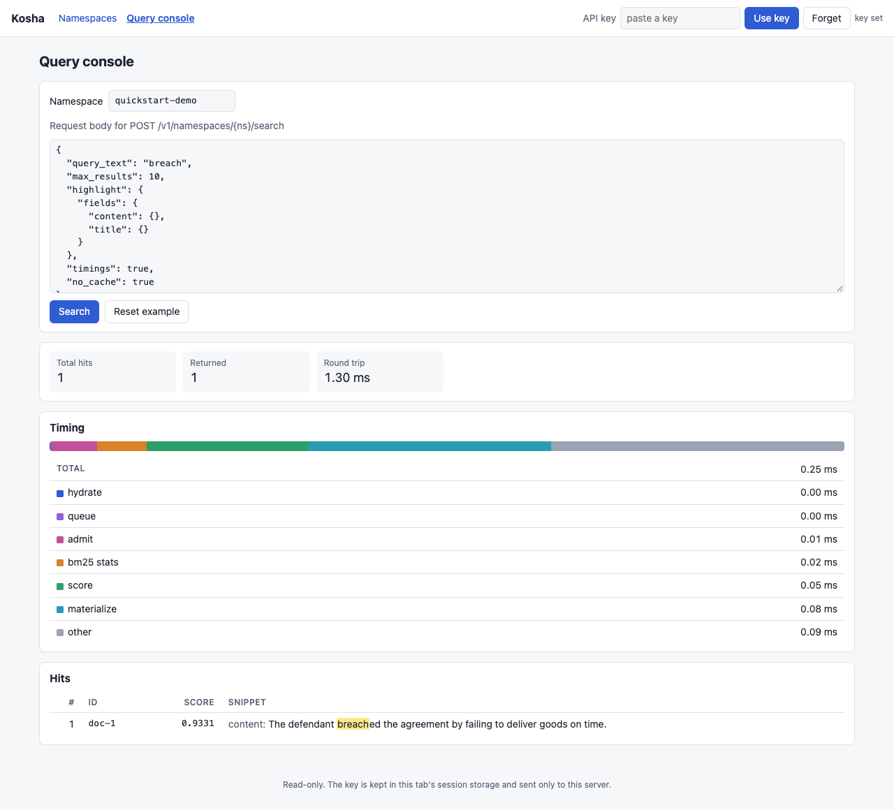
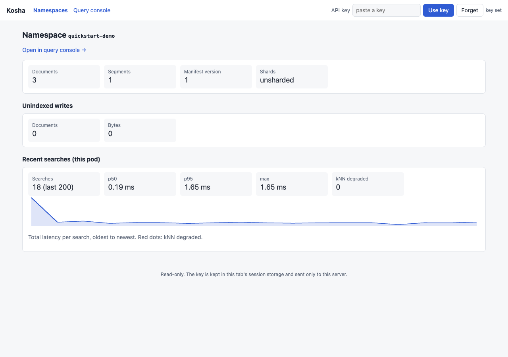
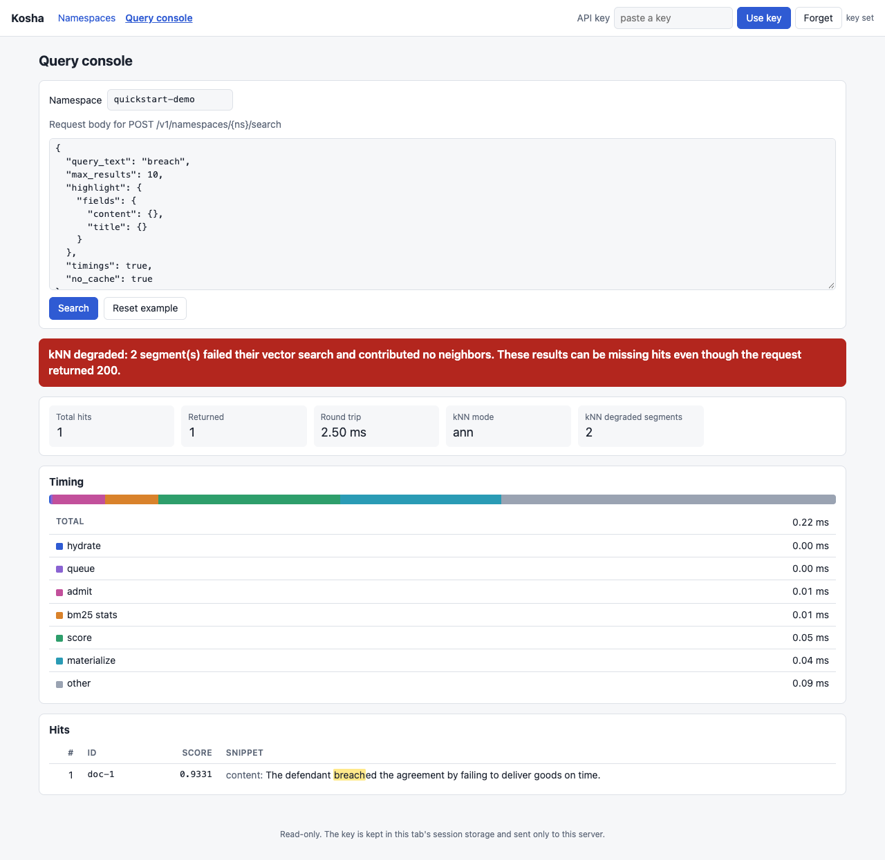

# Dashboard

`kosha-server` ships a small read-only web UI (#214). It is off by default.

    KOSHA_DASHBOARD=on

Then open `http://<host>:8080/dashboard`, paste an API key into the box at the top and press
**Use key**.

## Pages

- **Namespaces**: the key's tenant's namespaces with document count, segment count and manifest
  version (from `GET /v1/namespaces`).
- **Namespace detail**: `GET /v1/namespaces/{ns}/stats` laid out: totals, per-shard breakdown,
  branch lineage, manifest lag on a query pod (or unindexed writes on the ingest pod), and a
  sparkline of the last 200 searches' total latency on this pod with p50/p95/max. Searches where
  kNN degraded are marked in red.
- **Query console**: a JSON editor, prefilled with an example, that posts to
  `POST /v1/namespaces/{ns}/search`. It shows each hit's id, score and highlighted snippet, the
  timing breakdown, and a red banner when `knn_degraded_segments` is above 0 (a 200 that may be
  missing neighbors).
- **Usage**: monthly UTC tenant and namespace totals from `GET /v1/usage`, including reads,
  writes, vector dimensions written and stored bytes. Requires `KOSHA_USAGE_METERING=on`.

There are no admin actions.





With `knn_degraded_segments` above 0 (here a response rewritten in the browser to show the state):



## Security model

- The HTML, CSS and JS are compiled into the binary (`crates/kosha-server/dashboard/`) and served
  without a key. They contain no data.
- Every data call is made by the browser to the ordinary API with the pasted key, sent as
  `Authorization: Bearer`. The page sees exactly what that key's tenant can see. It cannot reach
  admin routes unless you paste an admin key, and admin keys have no tenant namespaces to list.
- The key is kept in the tab's `sessionStorage`, so it is gone when the tab closes. **Forget**
  removes it.
- Dashboard responses carry `Content-Security-Policy: default-src 'self'; frame-ancestors 'none'`,
  `X-Frame-Options: DENY` and `X-Content-Type-Options: nosniff`. The page loads nothing from other
  origins and renders all server data as text.
- Serve it over HTTPS (your ingress) anywhere but localhost: the key travels in each request.

## What turning it on changes

Besides the `/dashboard` routes, two API additions are only active with `KOSHA_DASHBOARD=on`, so
API output is unchanged by default:

- `GET /v1/namespaces/{ns}/stats` gains `recent_queries`:

  ```json
  "recent_queries": {
    "capacity": 200, "count": 37, "degraded": 0,
    "p50_ms": 4.1, "p95_ms": 12.8, "max_ms": 40.2,
    "samples": [{"at_ms": 1763600000000, "total_ms": 4.1, "hydrate_ms": 0.2,
                 "score_ms": 2.9, "hits": 10, "degraded": false, "cached": false}]
  }
  ```

  Samples are oldest first. Each pod keeps its own rings in memory: the last 200
  `POST` searches per namespace, for at most 256 namespaces (the least recently searched is
  dropped). They are lost on restart. Behind a load balancer each request may land on a
  different pod.
- A search body with `"timings": true` gets a `timings` object back:
  `total_ms`, `hydrate_ms`, `queue_ms`, `admit_ms`, `bm25_stats_ms`, `score_ms`,
  `materialize_ms` and `cached` (served from the result cache, so no phase ran), plus what
  the search pulled from S3: `s3_rounds` (sequential round trips), `s3_bytes`, and
  `fully_cached`. `fully_cached` is `true` only when the search made no S3 request of any
  kind (scaffolding, postings, kNN `vector.idx` ranges, page documents), nothing it needed
  was missing or shed, and it did not degrade a kNN segment or fall back to per-segment BM25
  statistics; a result-cache hit is fully cached. It is Kosha's counterpart to turbopuffer's
  `cache_hit_ratio == 1.0`, which a hot benchmark polls for before measuring. The field is
  ignored when the dashboard is off. The phase and S3 numbers are also on slow searches'
  `search timing:` log line (`KOSHA_SLOW_SEARCH_LOG_MS`).

`GET /v1/namespaces` itself is always available.

## Local try-out

    KOSHA_DASHBOARD=on KOSHA_DATA_DIR=$(mktemp -d) KOSHA_API_KEY=sk-dev cargo run -p kosha-server
    KOSHA_HOST=http://localhost:8080 KOSHA_API_KEY=sk-dev python3 scripts/quickstart.py
    open http://localhost:8080/dashboard    # paste sk-dev
