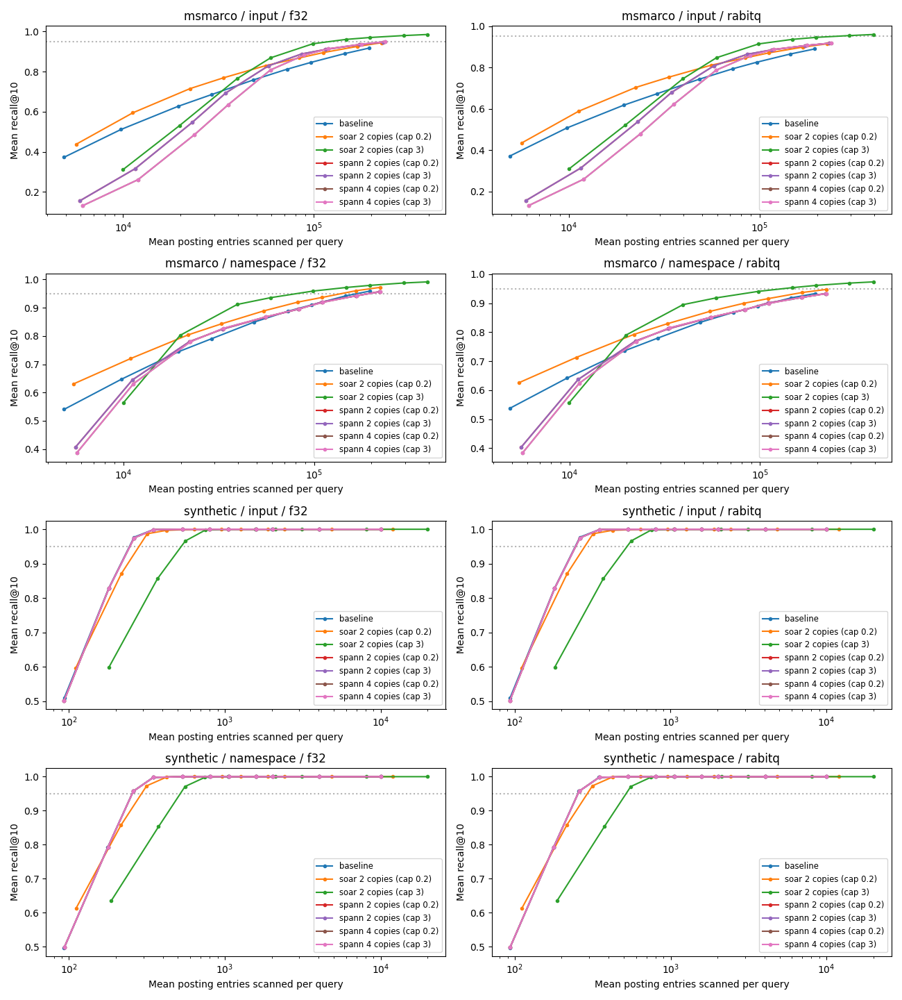

# Boundary replication experiment (#457)

The offline evaluator compares the existing single-owner SPFresh index to
SPANN closure (up to two or four total copies) and SOAR (one spill). Both
keep the original assignment from the completed build/rebalance. SPANN
uses Euclidean distance on unit vectors with a relative cutoff and rejects
a candidate if a closer, already selected centroid is closer to it than
the vector is. SOAR minimizes squared residual length plus the squared
projection onto the primary residual, weighted by `--lambda`. A zero
primary residual gets no projection penalty.

The spill caps are 20% extra entries and uncapped by default (`0.2,3`).
For the capped run, SPANN prioritizes the smallest relative candidate
distance and SOAR the smallest increase over the primary squared residual
length. The 20% cap is on **entry count**, not bytes; the report compares
modeled index bytes directly. Replicas stay in their segment, whether it was
cut in input order or placed by the shared #380 namespace head.

Each layout uses the same exact cosine ground truth, f32 rescoring
shortlist size, and a global posting budget. Sweeps include the 5%
reference from [#384](https://github.com/decover-tech/kosha/issues/384).
After spills are applied, the evaluator expands the receiving postings'
radii. It uses the server's centroid probe score (`--radius-alpha 1` by
default) with deterministic ordinal tie-breaking and an exact budget.

Each visited entry counts as a vector scanned, even on a duplicate hit.
For f32, an entry is an ID pointing into a single shared full-vector store.
For RaBitQ, every spill has a new residual code relative to its receiving
centroid. Repeated IDs keep their best approximate score, then the best
40 distinct IDs (configurable with `--rescore`) are reranked in f32.
The fixed shortlist isolates the sketch's behavior; it is not the
server's error-bound-driven rescoring implementation.

The byte model counts segment headers, centroids, ranges, radii and entry
payloads, not allocator overhead or the rest of a segment. f32 includes
one full vector per document, never one per replica. RaBitQ accounts for
IDs, residual norm and inner product, and padded sign codes; its shared
exact-vector store is excluded and remains the same size across variants.
This measures recall/scan/index-space tradeoffs, not end-to-end latency,
S3 I/O, or compaction cost. Live inserts, on-disk indexes, compaction and
deletion behavior are unchanged: the experiment reads live snapshots and
never passes replica assignments back to LIRE.

## Run and plot

```sh
RUSTFLAGS='-C target-cpu=native' cargo build --release -p kosha-build-segments --bin kosha-boundary-replication-eval
target/release/kosha-boundary-replication-eval --rescore 512 --probes .005,.01,.02,.03,.05,.075,.1,.15,.2,.4,1 > synthetic-457.csv

# Needs numpy, pyarrow and huggingface_hub; fetches ~4 GiB of f32 data.
python3 scripts/bench/bm25_scale/fetch_msmarco_embeddings.py --out-dir /data/msmarco-1m --docs 1000000
target/release/kosha-boundary-replication-eval --embeddings-dir /data/msmarco-1m > msmarco-457.csv

# Needs matplotlib. Prints the target-recall comparison and saves the curves.
python3 scripts/bench/bm25_scale/boundary_replication_report.py synthetic-457.csv msmarco-457.csv --out boundary-457.png
```

Without an embedding directory the evaluator uses the recall integration
test's seeded 10k-vector, 32-dimensional fixture and all 100 queries. The
MSMarco run uses the first 1M passage embeddings and 1,000 evenly spaced
real query embeddings from the shipped shards. Defaults are 2k vectors per
input-order segment for the fixture and 50k for MSMarco. The fixture is
already in cluster order, so use MSMarco to compare input-order and
namespace routing realistically. The fixture run uses a larger RaBitQ
shortlist: with 40 slots, none of the variants got above 0.251 recall
even when sweeping up to a full posting scan.

The summary compares the smallest observed scan count at or above
recall@10 = 0.95 against the matching one-copy baseline, with no
interpolation or extrapolation. The proposed bar is at least 2x fewer
scans and at most 20% more index bytes for RaBitQ. If a curve misses the
target, extend or refine `--probes` before drawing a matched-recall
conclusion. The same summary reports p10 per-query recall so an improvement
in the mean does not hide a worse tail.

## Results

Measured with the commands above on an 8-vCPU Intel Xeon VM, using the
default SPANN ε = 0.2, SOAR λ = 1 and radius weight α = 1.



MSMarco RaBitQ results (1,000 queries, up to 20% of postings probed):

| Layout | Variant | Peak recall@10 | Entries scanned at ≥0.95 | Index growth |
|---|---|---:|---:|---:|
| Input order | One copy | 0.8894 | — | — |
| Input order | SPANN, up to four copies | 0.9181 | — | +13.1% |
| Input order | SOAR, 20% cap | 0.9144 | — | +14.7% |
| Input order | SOAR, uncapped | 0.9594 | 295,534 | +73.5% |
| Namespace | One copy | 0.9334 | — | — |
| Namespace | SPANN, up to four copies | 0.9328 | — | +9.5% |
| Namespace | SOAR, 20% cap | 0.9474 | — | +14.7% |
| Namespace | SOAR, uncapped | 0.9735 | 147,371 | +73.7% |

**The proposed bar was not demonstrated.** Within this sweep, only
uncapped SOAR reached 0.95 for RaBitQ, exceeding the 20% byte allowance.
Neither RaBitQ baseline reached 0.95, so there is no measured scan ratio at
that target. On namespace f32, uncapped SOAR scanned 98,207 entries versus
195,237 for the baseline (1.99× fewer), but p10 recall fell from 0.90 to
0.80. Capped SOAR scanned 166,001 and kept p10 at 0.90. On the recall
fixture, capped SOAR scanned more entries at the target than the baseline
in both layouts; SPANN added at most 24 entries and made little difference.
