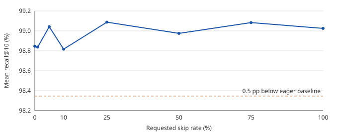

# Lazy nearest-partition assignment under churn (#462)

## Reproduce

```sh
cargo test -p kosha-vector-spfresh --locked --lib deferred_reassign_recall_curve -- --nocapture
```

The test emits one CSV row per cycle and skip rate, plus a summary for each rate.
It reuses the SPFresh churn test's 1,200-vector seed and 20 batches of 250
insert/delete operations with a drifting hot region (16 dimensions). Each batch
models one compaction: adopt the previous postings, remove deleted vectors,
absorb new vectors as loose entries, and rebalance. All runs use the same 120
queries per cycle (2,400 query evaluations per arm), five nearest-centroid probes
per query, and exact cosine top-10 ground truth from the live vectors.

The test samples only LIRE candidates verified to have a closer destination.
When it skips a move, the vector remains in its current posting. Queries neither
read the test-only move ledger nor probe wider. At cycle end the ledger keeps
at most one move per vector, discarding superseded moves and those whose owner
or endpoint centroids changed. It counts unique source and destination postings
of those pending moves. The next cycle applies the survivors whose vectors
were not deleted. No production format, config, or query path changes.

## Results



| Requested skip | Observed skipped / eligible events | Global NPA violations | Pending / live | Mean recall@10 | Recall drop vs. eager (pp) | Touched postings (mean / max per cycle) |
| ---: | ---: | ---: | ---: | ---: | ---: | ---: |
| 0% | 0 / 1548 | 5.059% | 0.000% | 98.846% | 0.000 | 0.00 / 0 |
| 1% | 23 / 1545 | 5.107% | 0.024% | 98.838% | 0.008 | 0.65 / 3 |
| 5% | 84 / 1559 | 4.809% | 0.041% | 99.042% | −0.196 | 0.90 / 4 |
| 10% | 153 / 1636 | 5.548% | 0.065% | 98.817% | 0.029 | 1.50 / 4 |
| 25% | 387 / 1684 | 4.772% | 0.157% | 99.088% | −0.242 | 2.75 / 7 |
| 50% | 1003 / 2077 | 6.106% | 0.482% | 98.975% | −0.129 | 5.25 / 8 |
| 75% | 2046 / 2777 | 6.944% | 1.416% | 99.083% | −0.238 | 7.55 / 11 |
| 100% | 3352 / 3352 | 9.253% | 2.371% | 99.025% | −0.179 | 8.70 / 15 |

Global NPA counts every live vector for which any other centroid is strictly
closer. It is nonzero even with eager LIRE because LIRE only checks a bounded
neighborhood around splits and merges. Pending/live counts only surviving
intents from skipped moves; both rates pool vector counts over all cycles.
Negative recall drops mean the deferred run scored higher; skipping changes
which subsequent splits and merges fire, so the responses need not be monotone.

No tested rate crossed the 0.5-point **mean** recall-loss bar. At 100% skipping
the model reached 9.253% global NPA violations and planned moves touching 8.7
of about 109 active postings per cycle on average. The worst single cycle at
that setting still lost 1.5 points relative to its paired eager cycle. This
is evidence about the synthetic churn fixture, not a production tolerance:
the run does not use the 10M benchmark corpus from #384, real compaction
fan-in, or a query stream concentrated on the newest hot region. Production
churn remaining within the observed range has not been established.
